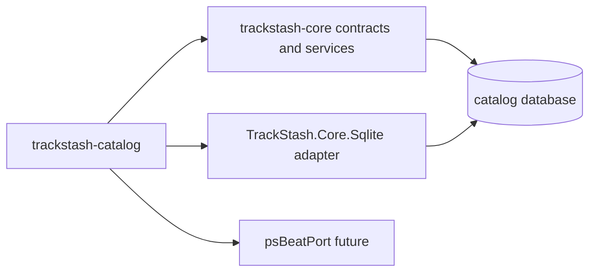

# trackstash-catalog

Canonical catalog and lifecycle operations module for TrackStash.

## Overview

Catalog + artwork and separately configured scanner inventory ZIP backup, verification and safe separate-directory restore are available through the shared native service, CLI and **System → Backup** admin GUI. Set `CatalogApi__ScannerDatabasePath` (or `TRACKSTASH_SCAN_DATABASE_PATH`) to enable scanner backups; CLI uses `--kind scanner`. Neither type copies audio/media files. See [database backups](docs/catalog-backups.md) for configuration, newest-10 retention per database/type, authenticated download and restore instructions.

## Reviewed filesystem media links

**Media** browses the existing scanner inventory and proposes links to existing canonical Recordings from embedded ISRC, title, explicit mix/version, primary Artist and duration evidence. It is not a new filesystem scan, a filename-based import or a workflow for admitting new Recordings. A valid ISRC with incomplete corroboration remains **Needs manual version review**, never an automatic link. Contradictory title/mix/Artist/ISRC/duration evidence blocks acceptance. Duration must agree within 2 seconds when both values are known; missing mix never implies Original Mix.

The list defaults to **Release groups**, rather than thousands of individual paths. Select **Label, Release, Artist, Track, Audio fingerprint**, or **Individual files**; groups are formed across all matching inventory rows before pagination. Literal Label/Release/Artist/Track filters and metadata search apply together when you press **Search**. Sort by title, Label, Release, Artist or library in either direction. **Organise Release** opens guided reconciliation; other groupings offer **Open group** to drill into their paginated files. **Back to groups** returns to the summary.

Library names are configurable under **System → Libraries** (also **Media → Manage libraries**). Rename a library, edit its absolute root directory, add more libraries, or disable unused ones. Names have no built-in Main/DJ/Backup roles; choose whatever names suit your collection. Full paths and scan dates appear in individual media review detail, not the list. A location name is not a verified backup coverage claim.

Each library has a stable, noneditable ID separate from its name/root. Renaming preserves media identities, frozen Recording reviews and Release associations. Disabling hides its inventory without deleting records/history. Relocating changes which recorded paths are in scope, but does not move media, rewrite scanner paths or change scanner ScanRoots; use the scanner's separate configuration and refresh after relocation.

Saving requires explicit approval of directory access and the original settings ETag; stale saves retain your edits and require **Reload saved settings**. Names/IDs must be unique, enabled roots distinct absolute directories, and at most 32 libraries are supported. Unmounted roots are allowed; media verification still rejects unavailable or symlinked paths. Changes take effect on subsequent requests without restarting the API.

Settings are persisted atomically in `<Catalog database path>.media-libraries.json` by default; configure `CatalogApi__MediaLibrarySettingsPath` to another absolute JSON file in an existing writable directory if needed. Preserve this file alongside deployment configuration: **Catalog/scanner database ZIP backups do not include it**. Corrupt/unreadable settings fail explicitly without reverting to defaults. When no saved file exists, legacy `CatalogApi__MediaLibraries__{id}` entries seed the screen using each ID as its initial name (JetDrive, Dropbox, NAS, etc.). Once GUI settings are saved, the saved list takes precedence over those environment defaults.

Release groups use embedded Label plus Release (falling back to album); case/outer whitespace differences group together, but different Labels stay separate. Track groups retain Artist, title, explicit mix and ISRC distinctions. Audio groups require an **exact stored fingerprint** and the same algorithm/version; latest complete versioned acoustic evidence is preferred, with separately namespaced legacy fingerprints as fallback. This is not fuzzy matching or proof of bit-identical files. Missing fingerprints stay separate, and no audio is read to generate fingerprints while browsing.

Within a Release group, **Find Catalog Releases** offers searchable, paged canonical Releases. **Review association** freezes the *entire* group (even when list filters show only part of it) and Catalog Release context. Title/Label differences are explicit manual-review evidence. A reason, unchecked confirmation and original review ETag are required to save the association. Stale metadata/membership or Release context blocks apply, reviews expire after 24 hours, and identical retries return the saved outcome. Accepted associations appear in grouped Media rows and **Release → Details → Associated media groups**. This separate association does not create Recording links, placements or acquisition/backup claims, read audio or write scanner data. Existing associations cannot be replaced. It uses schema-13 immutable review/apply history without a new migration and supports at most 100 files/group and 1000 accepted associations.

### Tick-and-accept media worklist

Open **Media matching** in the menu (or **Media → Match media in bulk**). It starts with individual files and proposed existing Catalog Recordings, using configurable library names rather than full paths. It defaults to 100 files per page; choose 25 or 50 for smaller batches. The same metadata search, Label/Release/Artist/Track filters, sorting and whole-inventory grouping are available. Open a group to review its paged files. Filters and groups cover the whole inventory; **Show on this page** is explicitly a page-local proposal/status filter.

1. Inspect the proposed Recording/version and expand **Match evidence and location** when needed.
2. Tick individual choices, or **Select supported proposals on this page** for unique supported choices. Nothing is selected automatically. Ambiguous/manual choices require an explicit Recording selection. Tag conflicts normally block, with the reviewed linked-audio exception below.
3. **Accept selected** verifies and accepts the selected batch. No reason field or second confirmation: checking/selecting the mappings and pressing Accept is your judgement. The server records that judgement, selected identities and frozen evidence in permanent per-file and batch audits.

Candidate discovery uses tagged ISRC/title and exact stored fingerprint copies across configured libraries and metadata groups. Complementary title, explicit mix (including a known mix appended to a title), Artist, ISRC and duration tags can support an incomplete copy. Repeated tags do not count as independent votes; conflicting supporting-copy identity evidence blocks composite support. Exact fingerprint evidence is historical and algorithm/version-scoped, not fuzzy AcoustID identification or fresh decoded-audio verification. Every copy used as composite support is byte/sidecar verified and its individual SHA-256 frozen, even when it is off-page or not selected for linking. A truncated Catalog candidate search is blocked rather than treated as uniquely matched.

**Already-linked audio copies:** when the exact stored fingerprint matches a reviewed accepted/manual copy of a Recording, incomplete or contradictory embedded tags (including different ISRCs) become visible **Metadata warnings**, not an absolute veto. Choose **Needs manual review: matches linked audio** in the Recording selector and accept your judgement. These choices are never included in **Select supported proposals**. The supporting copy must retain the fingerprint/path snapshot saved when linked and is verified against its originally accepted byte hash, then frozen/reverified with the batch. Missing/different fingerprints, unreviewed/rejected matches, sidecar conflicts and existing registrations cannot use this exception. No tags or Catalog ISRCs are rewritten.

**Find Release and admit:** each unlinked media row offers an inline Beatport lookup, seeded from its Release/album/title tags. The dialog retains that file and unregistered exact-fingerprint copies on the current page. Choose a Release, inspect its tracks, fetch complete metadata and use the existing reviewed importer (including Label and identity decisions). A cached non-purchase Release can be admitted without adding it to purchase history. Then tick and accept media proposals in the same dialog. Admission and linking are explicitly **two saves**: if byte verification/linking fails, the admitted Release remains and linking can be retried; admission is not undone or repeated blindly. Existing Catalog Releases skip admission. New/missing Labels still require Label maintenance; no Label is silently created. Lookup is an explicit metadata request, not an audio upload.

The batch is atomic: a failed/stale selected file or supporting copy leaves **all links and classifications unchanged**. This workflow deliberately links **Recordings only**. It does not infer a Release edition from audio/ISRC, associate unselected metadata groups or overwrite existing registrations. Use guided reconciliation below when you want to confirm a particular Release as well.

For private edits, remixes, bootlegs, self-releases and unmatched media, choose **Classify selected media → Unofficial / self-released** and tick the files. Classification is a separate **media worklist flag**, independent of Label: no “Not on Label” entity is created, and no existing Catalog Recording/Release is declared unofficial. Unmatched files can be classified without reading audio and remain unmatched; no Recording, Release or placement is admitted. **Media classification** filters this bucket across the whole inventory and can be combined with metadata filters/grouping. Choose **Clear classification** to remove the flag explicitly. Classification is per selected scanner identity, not automatically propagated to other copies.

Selection is page-local and clears when changing page, filters or grouping. Acceptance may hydrate cloud-only files; cancel explicitly if necessary. After an interrupted acceptance, **Check saved outcome** or **Retry same selected batch** recovers the original immutable result. A pending review ID (not an API key or media contents) is retained in this browser tab's session storage for recovery after navigation/reload. The normal login is still required. **Check then discard unaccepted review** checks for a completed save before starting over; forgetting a recovery pointer never undoes saved links.

No live scanner writes, file moves/retagging, external audio uploads, new Catalog entities or migrations are performed. Worklists use existing schema-13 review/audit tables and are included in Catalog database backups. Proposals/reviews support up to 100 selected files and 1000 related fingerprint-copy rows, with 100 candidate-search results per search. History is currently bounded to 1000 accepted matching batches; exceeding that fails explicitly rather than ignoring older classifications.

### Guided Release and track reconciliation

Track lists on Release, Label, Artist and Tracks pages share an expandable row: title/Artist, BPM, key, duration and **Copies** remain visible. The count includes reviewed accepted/manual links only; it is not live mounted-file availability. Counts are queried without loading file paths, scanner rows or audio. Expand the row's Details arrow to load media locations and fingerprint evidence, with Catalog credits/IDs further folded away. Recording detail likewise keeps media under **Media locations and file details**, collapsed by default, and shows BPM/key/copy count in its header. File actions such as backup, copy, retag, download, rescan, embeddings, deletion or re-assignment are not introduced by this layout change.

Recording detail shows linked copies by **current configured library name and file format**. Exact stored audio-fingerprint groups are highlighted, while missing/different fingerprints are explicitly distinguished from proven audio mismatches. Evidence is the scanner snapshot saved when linked, not a fresh AcoustID lookup or decoded-sample comparison. Renamed/disabled/relocated libraries retain their names through stable IDs. Expand **Location and file details** for full paths, SHA-256 and link dates. Different AIFF/FLAC byte hashes are expected even for equivalent lossless audio; hash equality is exact-file evidence, not the main audio comparison.

**Missing scanner hashes do not require a full rescan.** Explicit verification calculates a missing/blank SHA-256, freezes it in the Catalog review and checks the same bytes again at acceptance, including any fingerprint-supporting file. The scanner database is unchanged. Copies with identical audio can have different byte hashes because their tags/artwork differ; each copy is verified independently. This does not regenerate or independently revalidate stored acoustic fingerprints. A malformed nonempty hash or a file that differs from an existing scanner hash still requires refreshing that file's scanner record; changed tags may also make its stored metadata evidence stale.

1. Group by **Release**, then choose **Organise Release**. The guided screen covers the entire metadata group, not just the current page or filtered files. Individual file reviews remain available under **Show individual file reviews (advanced)**.
2. **Choose Catalog Release**: search and select an existing Release, or load the tracks of the group's previously associated Release. No new Release, Recording or placement is created.
3. **Review tracks and copies**: proposed copies are collapsed beneath the Release's existing Recordings, in Catalog track order, with library names and counts. **Select confident matches** includes unique supported proposals in one click; expand a track to inspect/select its eligible copies. Ambiguous matches, conflicts and existing registrations are kept in **Needs attention**, and Catalog tracks without proposed copies are shown separately. Nothing is preaccepted. Eligible manual choices remain explicit; blocked choices cannot be selected.
4. **Verify selected files and review**: checks SHA-256 and scoped sidecars. Exact stored algorithm/version-matched fingerprints can corroborate an otherwise incomplete copy using an independently supported file in the same group; that supporting file is also verified even when not selected for linking. Known ISRC/title/Artist/mix/duration contradictions are never overridden. There is no fuzzy AcoustID matching. Supporting files are hashed once per preparation, not once per copy; verification and final apply both read bytes and may download cloud-only files.
5. **Verify and confirm together**: inspect the frozen selected file-to-Recording mappings, give one audit reason and explicitly confirm the entire group's Release and all selected Recording versions. The batch saves the Release-group association (unless already associated identically) and selected file links in one Catalog transaction. A failure rolls back all new links/associations in that batch. Unselected files remain unlinked. Individual file, Release and batch audits are retained.
6. **Continue with remaining files** reloads current proposals and marks existing links without overwriting them. After an uncertain/cancelled save use **Check saved outcome** or retry the same review; identical retries are idempotent. Stale proposals/reviews require a reload/new verification, and frozen reviews expire after 24 hours.

Reconciliation is bounded to 100 group files and 100 existing Recordings on the chosen Release. It requires schema 13, but no new migration, scanner updates, media moves/copies, retagging or ownership assertions. For a Release association without any track links, expand **Release association only (without track links)** to use the separate metadata-only workflow described above.

Configure absolute server-approved library roots alongside the existing scanner database:

```bash
export CatalogApi__ScannerDatabasePath="/absolute/path/to/scanner.db"
export CatalogApi__MediaLibraries__JetDrive="/Volumes/JetDrive/Library"
export CatalogApi__MediaLibraries__Dropbox="$HOME/Library/CloudStorage/Dropbox-CloudOptionDJteam/David Alderman/Library"
export CatalogApi__MediaLibraries__NAS="/Volumes/music"
```

The workspace production launcher supplies these initial library defaults; the GUI can rename them and add more. The default NAS root includes historical `FromJetDrive` archive paths as well as `Backup`; location alone does not establish current backup completeness. Paths are approved only through library settings, never accepted in Recording-link requests. Unmounted files remain historical inventory items. Refresh using the existing scanner when inventory is stale; browsing never walks the volumes or reads audio.

1. Open **Media**, filter/search, and choose **Review media**.
2. Inspect tagged Recording candidates and blockers. **Verify file and prepare link** hashes the actual file with SHA-256, checks stored size/hash and validates any adjacent hidden `.trackstash-release.json` schema-4 sidecar. This explicit operation may download cloud-only Dropbox files. Symlinked files/root ancestors and conflicting or malformed sidecars are rejected. Sidecar local-file IDs are scanner-scoped evidence, not canonical Recording IDs.
3. Inspect frozen evidence, supply a reason and check the identity/version confirmation before accepting. Acceptance rechecks file/scanner/sidecar and Catalog snapshots with the original review ETag and atomically writes the media association and permanent before/after audit. Unapplied reviews expire after 24 hours; identical retries return the saved outcome. Changed evidence requires a new review.
4. Open the Recording to see accepted media copies. Multiple copies may share a Recording, but identical verified bytes cannot be newly linked to different Recordings. Existing registrations/links are never replaced.

Requires existing Catalog schema 13 for reviewed writes; no new migration or automatic live migration is added. Reads and reviews are authenticated and not cached. Inventory is bounded to 100,000 scanner rows, 25 files/page and 25 title-search candidates; Recording copy lists support at most 100 accepted links. This initial workflow does **not** move/copy audio, retag it, assert acquisition/ownership, update sidecars, add artwork or enable playback. Links describe verified review-time identity, not a continuous presence/backup check. See [API design](docs/api-design.md#reviewed-media-links-schema-13) and [request examples](src/TrackStash.Catalog.Api/Media.http).

`trackstash-catalog` owns the day-2 catalog workflows that happen after storage has been initialized.
It builds on shared contracts and services from `trackstash-core` and leaves first-run setup to `trackstash-bootstrap`.

This module is the long-term home for:

- canonical catalog ingestion
- catalog-oriented diagnostics
- lifecycle-safe repair and maintenance workflows
- read/query surfaces for other TrackStash modules

## Why This Module Exists

TrackStash needs a boundary between setup concerns and ongoing catalog work.
`trackstash-bootstrap` should remain small and focused on initialization, migrations, and starter orchestration.
`trackstash-catalog` should own the repeated workflows used during normal operation.

Examples:

- importing curated CSV batches into the canonical catalog
- ingesting Beatport or other external source data
- checking referential integrity and catalog health
- repairing derived indexes or denormalized search structures
- exposing catalog summaries to matching, tagging, and organization flows

## How It Fits In The Project

`trackstash-catalog` depends on shared domain contracts and reusable services from `trackstash-core`.
It should not introduce direct knowledge of SQLite internals into command handlers.



Related module docs:

- `../trackstash-core/README.md`
- `../trackstash-core/docs/ecosystem-modules.md`
- `../trackstash-bootstrap/README.md`

## Responsibilities

`trackstash-catalog` should own:

- operational catalog imports and refreshes
- canonical entity maintenance beyond first-run seeding
- catalog diagnostics such as integrity and completeness checks
- repair flows for indexes and derived search structures
- catalog-facing summaries and inspection commands
- reusable application-layer orchestration for future UI or service hosts

`trackstash-catalog` should not own:

- database bootstrap or migration initialization
- raw filesystem scanning
- audio fingerprint generation
- media-file writeback and tag mutation
- low-level repository and provider contract definitions

## Recording Identity Direction

Recording detail shows a 240-pixel release-cover hero on the left of its identity header, above the release listings; narrow screens stack the artwork above the title. Track links retain their originating Release in `releaseId`, so the hero uses that Release's explicitly preferred cover. Direct Recording links use the existing newest-release projection, labelled as such; they do not search other releases for a nicer cover. Missing covers use a placeholder, invalid Release context does not borrow unrelated artwork, and lookup failures remain explicit without hiding Recording details. The image is a local managed Catalog asset linked to its Release, not independent Recording artwork. The flexible header leaves room for future waveform/playback work but introduces no audio controls or waveform placeholders.

Use the canonical `Recording` entity for a track/master identity, independently of owned files. A recording may have no media files, may later acquire multiple file representations, and may appear on multiple releases. Remasters have separate recording IDs linked through `remaster_of`; a provider track ID or ISRC is supporting evidence, not the canonical identity.

The agreed policies live in core:

- [Recording identity, portable IDs, and remaster dates](../trackstash-core/docs/recording-schema.md#recording-identity-policy)
- [Identity resolution evidence and backfill safeguards](../trackstash-core/docs/media-matching-schema.md#identity-resolution-policy)

Catalog workflows should preserve assigned recording GUIDs and release memberships, including entries for music not owned locally. Proposed duplicate merges must retain resolvable retired IDs. Matching should produce reviewable file-to-recording decisions; the tagging layer should write `trackstash_recording_id` and appropriate standard date tags, not catalog command handlers.

These policies are a target for integration, not a statement that the live scanner database or current admission scripts already implement canonical recording links, redirects, or recording-ID tag writeback.

## Beatport-Backed Label Seeding

For an initial canonical label catalog, prefer existing Beatport track -> release -> label relationships over unverified media-file label strings. Give each distinct Beatport label ID a canonical GUID and retain the provider ID in `label_external_ref`, with source-table provenance in the payload. Deduplicate observations of the same provider ID across cache/corpus tables.

Use the shared `EntityNameNormalizer.NormalizeStrict` and `NormalizeLoose` helpers to expose name collisions and review candidates. Different provider IDs with identical names must not be silently merged; loose-name or embedding similarity is candidate evidence only. Keep possible imprints/parent labels separate until reviewed. Preserve observed names as aliases.

Bootstrap a separate catalog database through the existing migrations when the source is a scanner database with a different schema. Import through `validate-entity` and `apply-entity`, retaining the assigned GUIDs in reusable entity artifacts. Validate and preview each entity individually: the current validator accepts multi-document YAML, but the apply path expects a single entity document per file.

Seeding does not update media tags or establish file/release links automatically. A subsequent reviewed mapping stage is required for those relationships.

## Label HTTP API and Planned Clients

The [Catalog API design intent](docs/api-design.md) describes the implemented label-first ASP.NET Core host, shared application services, and React-admin GUI, plus a planned PowerShell HTTP client. SQLite remains a storage adapter, not part of the public API contract.

The host and GUI support label list/read/create/edit, alias/provider-reference inspection, and reviewed duplicate-label merges with audit and retired-ID resolution. Relationship editing, safe deletion endpoints, and the PowerShell HTTP client remain future work. The resource boundary leaves room for artists, releases, recordings (abstract tracks), genres/subgenres, and playlists without importing Beatport-specific identities or Library filesystem responsibilities.

### React-admin GUI

Artist browsing is available from the sidebar, linked Release/placement credits and the Label's Artists tab. Search name/sort-name/aliases, page identities and filter primary/remixer credits. Artist detail has Featured/Tracks/Releases/Associations/Details tabs, safe identity/provider metadata, one server-paged row per release/credited placement with aggregated roles and tooltip evidence icons; repeated placements, unplaced Recordings and unresolved compounds remain distinct. Release rows include managed cover thumbnails and linked Labels. Label context reflects credits on linked releases, not artist signing/ownership. Browsing uses schema 9+. Schema 12 adds manual biography/source, typed links, Favourite, private notes/review and managed portrait/gallery with permanent history and original-token conditional writes. The biography pencil edits just biography/source; a heart toggles Favourite, the portrait camera opens artwork management, and Beatport links use a locally bundled logo. Latest-release cards/newest-first ordering and calculated Associations remain planned; identity editing/split/merge is not included. No live database changes are made. See [Artist profile API](docs/api-design.md#artist-manual-profile-and-artwork-schema-12) and the [roadmap](docs/purchase-release-import-design.md#artist-experience-roadmap).

The [admin application](src/TrackStash.Catalog.Admin/README.md) provides searchable, sortable label lists, paged results, detail/alias/provider-reference inspection, and safe create/edit forms. It retains API keys in memory only, disables framework telemetry, and rejects stale edits using the form's original ETag.

Build it before building the API:

```bash
cd src/TrackStash.Catalog.Admin
npm ci
npm run build
cd ../..
```

Then start the API as below and open <http://localhost:5187/admin/>. Enter the key configured for that API. The .NET build copies built assets into its output/publish directory; users running the prebuilt output do not need npm. Source builds require Node.js 22.12 or later. See the [admin instructions](src/TrackStash.Catalog.Admin/README.md) for hot-reload development, tests, and packaging boundaries.

### Running the API Locally

From this module directory, configure an existing canonical catalog migrated to version 8 or later:

```bash
export CatalogApi__DatabasePath="/absolute/path/to/Trackstash.Catalog.db"
export CatalogApi__ApiKey="$(openssl rand -hex 32)"
dotnet run --project src/TrackStash.Catalog.Api
```

The generated key stays in the shell environment, not source control. Configure clients with the same key via their secret/environment facilities; never paste it into tracked files or URLs. A .NET user secret named `CatalogApi:ApiKey` is another option when running in Development. Do not select the scanner inventory database.

The host listens on `http://localhost:5187` (both loopback addresses when available). Change the port with `CatalogApi__Port`. General URL overrides do not enable remote hosting, and custom Kestrel endpoint configuration is rejected. The startup storage check refuses incompatible/uninitialized label storage without applying migrations or seeding.

Every API request, including OpenAPI, requires `Authorization: Bearer <key>`. Keys must have at least 32 characters and no whitespace. Only the public `/admin` shell/assets are exempt; they contain no credentials or catalog data. Browser requests may use the API's own origin or exact additional HTTP(S) loopback origins configured in `CatalogApi:AllowedOrigins`. For Vite development set `CatalogApi__AllowedOrigins__0=http://localhost:5173`; other origins are rejected. Do not deploy behind a proxy or expose over LAN; remote access, TLS, per-user permissions, and key lifecycle management need a separate design.

From another shell configured with the same key:

```bash
curl -H "Authorization: Bearer $CatalogApi__ApiKey" \
  'http://localhost:5187/api/v1/labels?page=1&pageSize=25'
curl -H "Authorization: Bearer $CatalogApi__ApiKey" \
  'http://localhost:5187/openapi/v1.json'
```

The [HTTP request examples](src/TrackStash.Catalog.Api/TrackStash.Catalog.Api.http) cover label CRUD/inspection, both-direction relationship editing, groups/memberships/derived related labels, and merge preview/apply. Reads/creates/edits of a single label, group or membership return a quoted opaque `ETag`. Send that exact value in `If-Match` when editing; missing headers return 428, stale versions 412. Membership writes additionally require both last-read endpoint versions. Configured browser CORS allows GET/POST/PATCH/DELETE, including authenticated membership removal. Do not retry ordinary creation POST automatically: create idempotency is not implemented.

### Manual Label Information

Open an existing label and choose **Edit** to manage description, country/city, founded year, lifecycle, personal notes, favourite, review status, and typed web links (including optional verification source URL). Create a label first, then edit its information. Saves use the original ETag and retain manual before/after revision history; name-only edits and existing CLI imports preserve profiles. Website links do not establish verified provider IDs.

Migration 5 adds this metadata and foundations for source-attributed observations and parent/imprint/distributor links between distinct labels. Migration 6 implements shared artwork and label galleries below. Relationship editing, automated enrichment/providers, and label embedding generation remain deferred. No external sites are fetched. Profile conflicts block a merge; compatible values/links and history carry forward. See [profile contracts](docs/api-design.md#manual-label-profiles) for limits and replacement semantics.

### Label Artwork and Galleries

On label detail, choose **Manage artwork**. Upload a JPEG/PNG logo or gallery image, record usage rights and optional source/attribution, then choose its caption and preference. Uploads save immediately. Reorder/edit/detach entries with **Save gallery changes**; **Replace image** uploads a new asset in the existing position, preserving the old image/history. Stale writes are rejected, not retried. Merges stack the retired label's gallery behind the survivor's, retaining the survivor's preferred image (or carrying forward the retired preference if none).

Originals and thumbnails are managed files **outside the database and Git repository**. The default is .NET's user `LocalApplicationData` directory plus `TrackStash/artwork-data`. Configure an absolute root with `TRACKSTASH_ARTWORK_ROOT` for native migration/tools and API, or override the API with `CatalogApi__ArtworkRoot`. Use the same root for both; changing it does not move existing assets. Roots within Git working trees are rejected. No API content route is public; the browser uses authenticated image requests without putting keys in URLs.

Upload limits: static JPEG/PNG, 10 MiB, 25 megapixels, 16384 pixels per side. SVG, animations, malformed images and oversized uploads are rejected. Original bytes/metadata are retained; 512-pixel JPEG thumbnails apply orientation and omit source metadata. Re-upload to change immutable provenance. Duplicate bytes are not automatically deduplicated across uploads with different source/rights.

**Back up the artwork root together with a consistent database snapshot.** A database-only backup cannot restore new artwork. A coordinated native backup/restore feature is on the [TODO list](TODO.md#shared-artwork-infrastructure); until then stop writers and preserve both matching stores. Detached assets are retained for history, not garbage-collected. Migration 6 exports populated legacy BLOB artwork to the configured root; it never edits migration 5. Unsupported legacy bytes remain preserved, but serving reports an explicit error. See [artwork design and operational rules](../trackstash-core/docs/artwork-design.md).

Release covers now reuse this infrastructure on **schema 11**. Click the cover/placeholder or camera to upload/replace static JPEG/PNG covers with rights/source/attribution, and edit gallery order/captions/preference/detachment; the redundant header management link is removed. The responsive header uses only an explicitly preferred cover, never a Label logo, and shows a Beatport logo link when a valid numeric release ID is known. Tracks use sequential presentation numbers, title/mix, primary Artists followed by remixers and duration; Label links remain in the header rather than repeating them in every track row. Listing and Recording credits are deduplicated by identity/role/spelling, without borrowing release-wide credits; separate provenance and stored numbering remain in expandable track details. No additional migration is required for these presentation changes.

Provider-neutral candidate lookup and explicit attachment are implemented, but **no live Beatport, MusicBrainz/Cover Art Archive or Discogs adapter is registered yet**. Without configured adapters, lookup explicitly reports this. Future adapters supply release-scoped candidate/revision IDs; attachment requires rights and confirmation and stores a validated local copy with immutable provenance. No automatic external-image loading or downloads occur.

Use a backed-up disposable catalog for testing: stop the trial API, migrate that same trial database to the current **schema 12** with the same artwork-root configuration, then rebuild/restart the trial API and refresh the browser. Do not migrate the live catalog without separate approval. Existing schema 9/10 Release browsing still works but Release artwork explicitly requires 11; Artist profile/portrait requires 12. Artist managed portrait/gallery reuses the same storage and rights rules; no Artist provider adapter is included. Recording release-context inheritance remains future work. See [shared artwork design](../trackstash-core/docs/artwork-design.md), [Release API routes](docs/api-design.md#managed-release-artwork-and-provider-candidates-schema-11) and [Artist API routes](docs/api-design.md#artist-manual-profile-and-artwork-schema-12).

### Reviewed Duplicate-label Merges

Open the label you want to keep, then choose **Merge duplicate into this label**. Search by name/alias or provider ID, choose the duplicate, and review the direction, retained provider IDs, aliases, release links, warnings, and blockers. Supply a reason and confirm explicitly. Switching the survivor or refreshing the review requires confirmation again; previews expire after 15 minutes.

One label can already hold several Beatport IDs. Apply atomically transfers supported links, coalesces compatible rows, preserves relational before/after audit evidence, and retires the duplicate ID. Conflicting payloads/roles, ambiguous primary flags, third-party provider conflicts, processing embedding work, and unsupported dependencies block apply. No automatic fuzzy matching, undo, media rewriting, or artist/release/recording merging is included.

Retired HTTP reads redirect to the survivor; writes return `409 label_retired` with the canonical ID. YAML/CSV imports and restores cannot recreate retired IDs, including dry runs of explicit label/release selectors. Merge applies are idempotent for the same operation/ETag/reason/operator; a changed or expired unapplied review requires another preview. See the [merge contract](docs/api-design.md#reviewed-label-merge-design).

**Upgrade before running this version:** stop the old API, make a consistent backup of the canonical catalog, then run the native bootstrap `migrate` command against that catalog (never the scanner database). For example, from the workspace root, after backing up:

```bash
dotnet run --project trackstash-bootstrap/src/TrackStash.Bootstrap -- \
  migrate --provider sqlite --db-path "/absolute/path/to/Trackstash.Catalog.db"
```

Migration 4 adds review/audit/retirement storage and guards, but does not merge or renumber existing labels. Startup refuses older schemas without changing them. Build the admin assets again before rebuilding the API. Protect database/backup access: full audit snapshots can contain provider payloads, and no HTTP endpoint exposes those snapshots. Applied operation outcomes, audits, redirects, and unused reviews are retained; cleanup and undo are not implemented.

### Shared Label Foundation

[TrackStash.Catalog.Application](src/TrackStash.Catalog.Application/LabelService.cs) implements label query/detail/create/conditional-update use cases against core storage interfaces, with no SQLite dependency. Supply a configured `IStorageProvider`; callers cannot select a database through label requests.

Queries return `{ items, total, page, pageSize }`, search names/aliases with shared strict normalization, preserve ambiguous candidates, and support stable sorting and pages up to 100. Updates require the last-read opaque version and distinguish missing labels from stale edits. Explicit field flags preserve omitted values and allow clearing nullable sort names.

The HTTP host requires explicit catalog migration to version 8 before use; it never migrates at startup. Take a verified catalog/artwork backup before upgrading. Existing schema 6 and 7 backups remain supported. Aggregate-version triggers invalidate tokens for label, alias, provider reference, release-label, profile/artwork and both endpoints of relationship/membership changes. Unconditional writers still invalidate versions but must reject retired-ID reuse. The HTTP host uses `ILabelService`, `ILabelMergeService`, `ILabelRelationshipService` and `ILabelGroupService`; no new CLI commands are included.

Label detail supports reviewed **imprint/parent** and **distributor** relationships, inverse navigation, source/evidence/notes, multiple parents, and deliberate conditional save/removal. Migration 7 preserves existing edges, baselines immutable history and rejects imprint cycles. Merge review transfers both directions, coalesces only matching evidence, and blocks conflicts/self-links/cycles. See [relationship contracts](docs/api-design.md#reviewed-label-relationships); dates/territory and automatic enrichment are deferred.

The imprint editor also manages child imprints and distributed labels from their parent/distributor page, storing the same single directed edge. **Label groups**, beside Labels in the sidebar, manages distinct families/brands and organisations with flat, sourced memberships, current/former/unknown status, partial dates and permanent history. Edit the same membership from either endpoint; a return from former to current requires extra review. **Related labels** derives shared recorded-parent, same-family and same-organisation reasons without redundant sibling edges or ownership claims. Migration 8 introduces empty group tables, group-aware merge reviews and conflict-safe transfer. Group nesting, merge/deletion and artwork/aliases/provider references remain deferred. See [group contracts and rollout gates](docs/label-groups-design.md).

See the [implemented contract and remaining decisions](docs/api-design.md#implemented-foundation) for details.

### Next: Reviewed Purchase-to-Release Import

Canonical **Releases** can now be browsed from the left menu or a label's filtered **Releases** tab. Search title/catalog number, page results and click a title to view release metadata, label links, release credits and ordered Recording placements with their own credits. Release detail defaults to **Tracks**; **Details** groups the artwork gallery, provider links (including Beatport), SonoVault enrichment and catalog/provider identities below the shared header. The selected tab is stored in the URL (`tab=Tracks` or `tab=Details`), preserving other parameters and browser navigation. Panels load on first visit and remain mounted while switching tabs, retaining track pagination and in-memory enrichment comparisons without repeating lookups. Enrichment is still read-only; these tabs do not add apply operations. Import outcomes also link directly to **View release**. Browsing is read-only and requires schema 9+; no migration, media inventory or purchase accounting occurs.

The [release-centred import design](docs/purchase-release-import-design.md) uses a purchase/corpus candidate to review one complete Beatport release, resolve its existing label, and create accepted recording placements and individual artist/remixer credits. The first **read-only inspector** is available in **Purchase releases** in the admin sidebar and through:

- `GET /api/v1/purchase-release-candidates?q=325565&page=1&pageSize=25` (add `hideAdmitted=true` to omit releases already in the catalog, and `readyOnly=true` to keep only releases with a complete cached source and exactly one matching catalog label)
- `GET /api/v1/purchase-release-candidates/325565?page=1&pageSize=25`

Set `CatalogApi__PurchaseSourceDatabasePath` to an absolute existing scanner inventory path containing the Beatport corpus/cache tables. If absent, the inspector uses `CatalogApi__ScannerDatabasePath` (or `TRACKSTASH_SCAN_DATABASE_PATH`). The source must be separate from the canonical catalog. Restart the API after configuration/build changes. An unavailable, unconfigured or unsupported source returns safe 503 Problem Details, not an empty success.

The initial queue uses derived purchase-corpus flags, **not receipt accounting**. Inspections expose structured primary/remixer credits, label candidates, cached timestamps, whole-release completeness diagnostics and a source digest, with tracks paged separately. Source completeness does not certify canonical identities or official order; even a complete source requires reviewed import later. Source connections are read-only and never migrate, fetch or update the scanner; the inspector does not write canonical rows either.

**Reviewed apply is implemented for schema 10**, tested only on temporary catalogs. From an inspected release, create an immutable server-side preview, review individual Artist/Recording choices (including unresolved compound identities), and apply with the original ETag, reason and deliberate confirmation. The transaction includes the complete release, placements/credits, accepted references, permanent source/decision/before/after audit, a replay-safe outcome, canonical text documents and durable pending embedding work. No vector generation or media/purchase assertion occurs.

Decision edits create a new immutable preview and supersede the previous one; previews expire after 15 minutes. Source or catalog changes reject apply rather than silently retrying. Existing accepted source content produces a no-op, including an identical cache refresh. Changed or unreviewed existing release graphs are blocked until a separate reconciliation workflow is available; curated metadata and manual order are never replaced. Label identity must already resolve to exactly one active catalog label. Receipt ingestion, provider refresh, Artist split editing and scanner-media resolution remain deferred.

The label/inspector host still supports schema 8. **Do not migrate the live catalog just to inspect releases.** Import requires a separately approved migration through 9/10 after backup verification and rehearsal; no startup or preview operation migrates a database. See the [review/apply contract](docs/purchase-release-import-design.md#implemented-reviewed-import-migration-10-temporary-databases-only).

The minimum shared canonical foundations are now implemented in forward migration **9**, with conditional versions, Artist identity status, Release metadata, Recording duration, stable multi-role credits and repeated placements/manual ordering. They have been validated on temporary databases; **no live upgrade or import has occurred**. The existing label/inspector API remains schema-8 compatible. These are storage foundations, not new public entity editors or reviewed apply endpoints. See [foundation status and remaining work](docs/purchase-release-import-design.md#6-required-core-changes).

### Beatport Broker: Backfill and Browse

When the [Beatport broker](../trackstash-beatport-broker/README.md) is running (`start-prod.sh` starts it and sets `CatalogApi__BeatportBrokerUrl`/`CatalogApi__BeatportBrokerKey`), the catalog API proxies Beatport through it. The broker holds the Beatport session, caches responses and throttles requests; the catalog never stores Beatport credentials.

- **Sign in / status:** `GET /api/v1/beatport/connection`, `POST /api/v1/beatport/sign-in`, `POST /api/v1/beatport/sign-out` (also from the **Purchase releases** page).
- **Backfill purchase data:** `POST /api/v1/purchase-release-candidates/{id}/beatport-backfill` for one release, or the background job at `/api/v1/beatport-backfill-jobs`. Fetched data lands in the broker's tables in the scanner database, which purchase readiness reads.
- **Browse (read-only):** the **Beatport** page in the admin sidebar. Search releases by name and/or Beatport label, sort by newest/oldest/name, expand a release to see its tracks, and search labels by name. Each result shows whether it is already **in the catalog** (via Beatport external references) or in your **purchase history**.
  - `GET /api/v1/beatport/releases?q=&labelId=&artistId=&sort=newest|oldest|name&page=1&pageSize=25` (`q` or a filter is required; `pageSize` ≤ 50)
  - `GET /api/v1/beatport/releases/{id}` (release plus up to 100 tracks)
  - `GET /api/v1/beatport/labels?q=&page=1&pageSize=25` and `GET /api/v1/beatport/labels/{id}`

**Label and Artist pages also have a Beatport tab** that browses store releases inside the entity page, using its verified Beatport external reference. The label header's **Browse on Beatport** button opens this tab rather than leaving the label. Primary IDs are preferred; if several IDs are recorded, choose one with the identity selector. With no usable ID, the tab explains what is missing instead of guessing by name. Search, sort and paging stay scoped to that identity and are retained in the URL independently of catalog filters. Track expansion and catalog/purchase markers are shared with the standalone browser. Store requests only start when the tab is opened.

**Admit purchased releases:** a purchased release without a catalog match has an **Admit to catalog** button in both entity tabs and the standalone browser. It opens the existing immutable import review in a dialog without leaving the page. Create a preview, review/save identity choices, and explicitly confirm before applying. The row gains its catalog link after a successful apply. Closing a review does not apply it; dismissal is disabled while a review request is running. Source-completeness, label-resolution and stale-preview checks remain enforced by the existing import API. Incomplete sources link to Purchase releases for inspection/backfill. Admission creates catalog metadata, not media copies or links; it does not purchase anything from Beatport.

The admission dialog also has **Fetch missing from Beatport**, using the same backfill operation as Purchase releases. Fetching and reviewing cannot run concurrently, and the dialog cannot be dismissed during either operation. A successful fetch displays its completeness/blocker summary and clears the old preview/decisions so a fresh preview uses the updated source. A failed fetch shows its error without discarding the existing review. Fetching never applies an import.

Browsing never writes to the catalog and never adds purchase candidates; responses are only cached by the broker. Errors use Problem Details: `409 beatport_sign_in_required` (sign in first; 409 so the GUI doesn't log you out), `503 beatport_broker_not_configured`/`beatport_broker_unavailable` (start the broker), `404 beatport_release_not_found`/`beatport_label_not_found`, and `400 validation_failed` for bad query values. Beatport is the discovery/shopping integration; playlist/cart writes and audio previews are not implemented. SonoVault is the preferred next enrichment source, subject to a read-only matching/coverage pilot and reviewed changes rather than automatic overwrites. A local wishlist remains a proposal, not a prerequisite for future Beatport playlist/cart integration: see [docs/beatport-wishlist-design.md](docs/beatport-wishlist-design.md).

### Metadata Enrichment Provider Boundary

The application layer defines [`IEnrichmentProvider`](src/TrackStash.Catalog.Application/EnrichmentProvider.cs) for server-registered, read-only metadata adapters. [`SonoVaultEnrichmentProvider`](src/TrackStash.Catalog.Application/SonoVaultEnrichmentProvider.cs) supports Recording, Artist, Label and Release lookups. Recording/Release pages and Artist/Label **Details** views have **Find enrichment on SonoVault**, displaying candidate comparisons without canonical writes. Recordings and Releases also offer Beatport lookup and selective reviewed apply from either provider on schema 13; Artists and Labels remain lookup-only.

- Providers advertise which of Recording, Release, Artist and Label they implement.
- Lookups receive a public metadata snapshot with canonical ID/version and source identifiers, not private notes, audio or filesystem paths.
- Results retain provider/edition identity, match reasons and conflicts, typed proposed values and per-field source evidence. Provider IDs are not canonical catalog IDs; ISRC matches do not automatically establish remix/version identity.
- Missing values mean no proposal, never deletion. Credits and references are additions to review, not instructions to replace curated lists. Release editions remain distinguishable.
- A successful no-match returns an empty candidate list. Authentication, configuration, quota, network and unsupported lookup failures remain explicit errors; caller cancellation propagates.
- Future implementations register through ordinary .NET dependency injection. No dynamic plugin loader or additional service is required. Catalog's reviewed-apply service validates candidates and freezes proposals before version-checked, audited acceptance; adapters cannot apply changes themselves.

SonoVault is the intended first adapter. Beatport shopping/backfill remains independent. Audio embeddings remain in the audio-worker/similarity pipeline; BPM and musical key are metadata outputs with provenance, not values inferred from an embedding vector.

#### SonoVault configuration and initial limits

Set `CatalogApi__SonoVaultApiKey` in the environment of the catalog process. `start-prod.sh` inherits it; do not put the key in that script, a committed configuration file, browser code or chat. In the default macOS zsh, read it without echoing it or storing its value in shell history:

```sh
read -rs 'CatalogApi__SonoVaultApiKey?SonoVault API key: '; echo
export CatalogApi__SonoVaultApiKey
./start-prod.sh
```

The adapter makes no requests at startup. Missing configuration fails explicitly when a lookup is requested. Existing SonoVault Recording IDs take precedence, followed by ISRC, then artist/title search (including the requested mix name). Each lookup makes one GET to the fixed official HTTPS API: no automatic retries, follow-up link requests or pagination. Search is limited to ten candidates; more results produce a warning. Responses are limited to 1 MiB with a 30-second request/body deadline; redirects are disabled in the host client.

Artist and Label lookup uses a single existing SonoVault ID first, otherwise a name search. Neither Beatport IDs nor name matches are silently accepted as SonoVault identities. Authenticated `POST /api/v1/artists/{id}/enrichment/sonovault` and `POST /api/v1/labels/{id}/enrichment/sonovault` load authoritative public identity snapshots; private profiles and notes are never sent. Candidates preserve name conflicts and conflicting known MusicBrainz/Wikidata Artist identities. Artist proposals include the documented country of origin, formation year/date, social handles or URLs, and MusicBrainz/Wikidata IDs when supplied. The year/date may represent birth for a solo act or formation for a group: they are not automatically mapped to a catalog founding date. Social values are displayed as plain text, not guessed links. Current profile fields are explicitly outside this identity snapshot rather than claimed to be missing. Label coverage is currently name and identity only, matching the official SDK's documented fields. No release/artist lists or follow-up details are fetched; no catalog browsing, identity acceptance, artwork import, schema change or writes are added.

Release lookup (`POST /api/v1/releases/{id}/enrichment/sonovault`) uses a known SonoVault Release ID first, otherwise title search with known primary Release artists. Placement/Recording artists and remixers are not borrowed as Release identity. SonoVault supports an Artist search parameter, but no Label parameter: known Labels are compared locally. All returned candidates remain visible, stably ordered by the number of known title/Artist/Label conflicts (and selected-edition catalog-number conflicts). Comparisons are conservative trimmed, case-insensitive name comparisons, not fuzzy matching or accepted identity. Missing provider Artist/Label evidence is flagged when the catalog has that information. The provider may return only one group Artist; agreement does not prove full credit or edition equivalence.

**Fetch details for candidate** explicitly calls `POST /api/v1/releases/{id}/enrichment/sonovault/candidates/{candidateId}`; **Inspect edition** adds `?editionId={editionId}`. Each click makes one bounded provider GET, with no automatic detail fan-out or pagination. Detail results replace the visible comparison using a freshly loaded catalog identity snapshot. A failed detail request preserves the prior comparison and shows the error. Returned Release and requested edition IDs must agree with the request. The view retains edition source identities, format, date precision, Label, catalog number, barcode and track count. A group date is not proposed as a canonical edition release date; year/month-precision edition dates are shown explicitly rather than presented as exact days. MusicBrainz release IDs spanning editions remain separate from release-group IDs and are not promoted to accepted catalog links. Unselected tracklists are explicitly provider consensus evidence; selected-edition numbering is shown only after explicit inspection. Track titles remain raw (possibly including mix); no new Recordings, credits, ownership or media assertions are created. See [Enrichment.http](src/TrackStash.Catalog.Api/Enrichment.http) for requests.

#### Reviewed SonoVault apply (Recordings and Releases, schema 13)

1. Look up candidates and, for edition metadata, explicitly inspect a Release edition.
2. **Prepare review for candidate** fetches that chosen SonoVault identity once more and freezes the response with the original catalog state. The new response is shown as the **Frozen proposal**, not silently treated as identical to the earlier lookup. A changed catalog returns `412 enrichment_state_changed`; a missing candidate or conflicting returned identity is explicit.
3. Select individual, initially unchecked fields. Recordings support title, separately verified mix, valid ISRC, BPM, key with notation, genres/subgenres and an optional preferred classification. Releases support title and explicitly selected edition catalog number, barcode and exact day-precision date. Group dates, year/month dates and unverified durations remain evidence, not canonical exact values.
4. **Accept SonoVault identity** is a separate checkbox. It adds a non-primary reference only when no conflicting identity exists on this entity or another same-kind entity. Existing provider refs are preserved; MusicBrainz edition/group identities are not copied. ISRC conflicts do not merge Recordings.
5. Give a review reason, confirm entity/version identity, and **Apply selected metadata**. Only selected fields are updated; all credits, placements, Label links, source payloads and unselected metadata are preserved. Changing a Recording affects every Release using it. Credits, Labels and tracklists need canonical identity mapping and are not selectable in this scope.

#### Beatport lookup and reviewed apply (Recordings and Releases, schema 13)

Choose **Beatport** in the Recording or Release enrichment provider selector; switching provider clears the comparison/review without making a request. Beatport uses the existing authenticated caching broker, never SonoVault credentials. Recording lookup uses an accepted Beatport track ID first, then ISRC, otherwise title/mix with a known single primary Artist filter. Multiple primary Artist names are compared locally. Search returns at most ten candidates in one broker call; no pagination or automatic retries occur. Title and mix are retained separately, `length_ms` is displayed as duration evidence, and `key.name` is retained in musical notation. Genres and optional `sub_genre` classifications remain distinct.

**Prepare review for candidate** explicitly refetches the selected track in one broker call, or Release plus its first 100 tracks in two calls. The shared frozen-review, original-ETag, expiry, full-state checks, reason/confirmation, immutable history and replay rules below apply equally to Beatport and SonoVault. Recording writable fields are title, mix, valid ISRC, BPM, musical key, genre/subgenre and explicit preferred classification; duration remains evidence only in this scope. Releases offer title, catalog number and validated `yyyy-MM-dd` Beatport publish date. Beatport has no SonoVault edition selector; no barcode or Release classification is invented from its tracklist.

**Accept Beatport identity** is an independent, initially unchecked option. Same-kind identity conflicts, including numerically equivalent IDs with leading zeros, block the entire apply transaction. SonoVault and other existing references are preserved. Accepting a Release identity enables its linked Beatport artwork lookup, but metadata apply does not download/attach artwork, create media/purchases, change credits or Label links, or accept the provider tracklist. Use the artwork manager separately for explicit preview/attachment.

Genres and subgenres remain separate lists. Selecting one replaces that list with the frozen proposal; missing lists are never deletion requests. Preferred classification is an explicit choice from provider labels retained in the resulting lists, not an automatic preference for the subgenre. A replacement that would discard the existing preferred classification requires an explicit retained choice rather than silently clearing it. Metadata is shown on Recording/Release detail and Recording-based track lists; musical keys retain their notation.

Reviews expire after 24 hours and require their original strong `If-Match` on apply. The transaction rechecks complete canonical entity/credits/placements/musical metadata state, then saves immutable before/after history, selected intent, reason, frozen source identity, edition and field evidence. A repeated identical apply returns the original saved outcome without provider calls; changed selections, preferred classification or reason conflict. Stored reviews can be retrieved from `GET /api/v1/enrichment-reviews/{id}`. No automatic retries, bulk updates, provider track admission, purchase assertions, media linking or tag writes are added.

Schema 13 is supplied by `trackstash-core`, including typed musical-metadata storage and immutable review/apply tables. **Do not run a live migration implicitly**: make and verify a catalog backup first, stop the API, and migrate only a separately approved catalog. Lookup still works on older supported schemas; review preparation returns `409 enrichment_schema_required`. Schema 13 backup/restore includes canonical musical metadata, frozen evidence and apply history. Review history and musical metadata block legacy destructive replacement/deletion.

#### Release provider choice and Beatport artwork

Release **Details** offers a metadata-provider selector for **SonoVault** or **Beatport**. Switching providers clears the transient comparison/review but does not make a request. Beatport uses the existing caching/sign-in broker, not a new credential store: a name search uses one broker call, while linked-ID/candidate details use two calls (Release and the first 100 tracks). Known title, primary Artist, Label and catalog-number conflicts rank returned candidates without discarding them. Lookups remain read-only; selective apply is available separately for either provider. Beatport Release dates are shown as provider release dates, not SonoVault group dates.

**Review matched tracks for candidate** offers a separate Beatport Release-to-Recording batch on schema 13. It fetches the Release and first 100 tracks once through the broker, retaining each track's own title/mix, ISRC, BPM, musical key, genre/subgenre and evidence. No track-detail fan-out or automatic retries occur. Catalog Releases with more than 100 placements are rejected before fetching; incomplete provider tracklists are explicitly warned about.

Matches are restricted to Recordings already placed on the selected catalog Release. An accepted Beatport Recording ID takes precedence; otherwise confidence requires a valid exact ISRC, exact trimmed/case-insensitive title and nonblank mix/version, and complete primary Artist-name agreement. Conflicting known identities, ISRCs, title/mix or available primary Artist evidence block confidence, including when a provider ID is accepted. Title-only possibilities, duplicate source tracks and non-unique mappings stay ambiguous; unmatched catalog/provider tracks are also displayed. Numbering alone is never an identity match, and missing mix evidence is not guessed to mean Original Mix. Provider tracklists still do not create Recordings or rewrite placements.

Only unique confident matches offer field checkboxes. Missing values/lists default selected, but existing values, preferred classification and **Accept Beatport identity** require explicit selection. Review the provider Release/version, selected fields and reason before confirming **Apply selected track metadata**. All selected Recording writes and individual/batch audits succeed in one transaction or none do. Release context, selected Recording snapshots and primary Artist agreement are rechecked; frozen proposals are used without any provider calls. Drafts expire at 24 hours; identical retries return the original outcome even after expiry. Batch child reviews cannot be applied individually.

The batch and per-Recording frozen evidence/history reuse schema-13 review storage and are included in coordinated catalog backups. No additional migration is required. Changing a Recording updates its metadata across every Release appearance, while unselected fields, credits, Label links, placements, source payloads, artwork, purchases and media remain untouched. SonoVault batch matching and catalog-only admission of Beatport Label releases are follow-up work; catalog admission will not imply a Beatport purchase or owned media.

When the Beatport broker is configured, the Release artwork manager offers Beatport candidates for a single already-linked Beatport Release ID. A name-search result is not automatically accepted as an artwork identity. **Look up artwork candidates** retrieves metadata only; **Preview artwork** explicitly downloads and validates a thumbnail through Catalog, without storing an asset. **Attach candidate** requires release-match/usage-rights confirmation and the original gallery ETag. It creates a managed copy with source identity/revision and permanent history. Candidate revisions describe the provider metadata and image URL, not a guarantee that upstream bytes at the same URL never change; downloaded bytes have their own immutable managed asset hash. Artwork transfers are restricted to HTTPS `geo-media.beatport.com`, no redirects or credentials, with 10 MiB and 30-second bounds plus existing image/pixel limits. Attachment preserves the current preferred cover by default; explicitly select **Prefer the attached candidate** to change it. Upload and gallery preference editing remain available independently. Source/rights are evidence, not automatic licence verification.

#### Linked Library embedded-artwork integration (design only)

Embedded artwork is deliberately **not implemented as a browser media-file picker**, and Catalog has no arbitrary-path media extraction endpoint. The scanner already stores `media_file_id`, content hash, path and `metadata.artwork_hash`; the Library's hidden release sidecars describe release/track/provider evidence and media-file instances. The v4 sidecar schema does not establish accepted canonical Catalog Release/Recording IDs by itself. Neither a matching release name nor `artwork_hash` alone establishes a canonical release link or makes image bytes available.

The next integration should have this boundary:

1. Establish an explicit, reviewed Catalog Release/Recording-to-Library identity link, scoped to the scanner/library identity (a numeric media-file ID alone is not globally unique). Preserve the supporting sidecar/provider evidence; unresolved editions remain held, not inferred from folder names.
2. Add a Library-side read-only artwork candidate operation using that accepted link. Library resolves approved roots and current file instances, rejects paths outside roots/symlink escapes, verifies the current media content hash, and extracts bounded embedded picture records without modifying tags or uploading audio.
3. Return opaque release-scoped candidate IDs, revisions containing media and picture hashes, picture type/index, dimensions, and a safe Library identity—not filesystem paths—to Catalog. Distinguish front-cover/other pictures; do not silently select the first picture or conflate copies on JetDrive/Dropbox/NAS. Equal picture hashes can be deduplicated while retaining every contributing media identity.
4. Provide an authenticated bounded image-read operation. Revalidate the accepted link and media/picture revision at preview and attachment; missing/offline/changed media must produce explicit errors. No request-supplied path is accepted. Catalog runs the same image validation and uses its existing version-checked, audited managed-copy/gallery workflow.
5. Present **Beatport** and **Library embedded artwork** as alternative candidates with provenance and explicit preferred-cover selection. Neither source automatically wins: embedded artwork may match the purchased edition but can be stale or low resolution; Beatport can be better quality but may reflect a different issue. Ownership does not imply redistribution rights.

This requires the linked-identity contract and a Library operation/transport, plus a source descriptor for internal Library provenance (the existing external candidate contract requires an HTTPS source page). It does not require giving Catalog access to all media, copying audio, altering scanner tags, or choosing a global preferred provider. Rehearse on fixtures with multiple pictures, duplicate copies, ambiguous edition links, offline media, changed hashes, cancellation and stale catalog versions before enabling it against the live Library. Until then only Beatport and manual image uploads are available; no placeholder embedded provider is advertised.

Title, ISRC, BPM, Camelot key, genre/subgenre labels, Artist credits and the SonoVault Recording ID are proposed with SonoVault attribution. No upstream field provenance is invented. SonoVault may combine title and mix as `Flat Surfaces (Kohra Remix)`: the adapter separates them only when both the base title and trailing parenthesized mix match the catalog's existing values (case-insensitively). Evidence retains the original title and explains the derivation. Unknown or differing mixes and parentheses within titles are not guessed or stripped; unresolved version warnings remain. Duration units still need verification, so duration is not proposed; Recording lookups also do not infer label/date from an arbitrary release appearance. Truncated results are reported as limitations. Free-tier allowance is not tracked locally yet: do not start bulk work until quota accounting/caching is implemented.

Genre and subgenre proposals retain every returned label in separate `genres` and `subgenres` arrays, with separate field evidence. The comparison displays both, for example **House** and **Progressive House**, without inventing parent-child pairings when multiple labels exist. The older scalar `genre` proposal remains populated only for a single genre for compatibility. Schema 13 supports reviewed canonical lists and an explicit preferred classification such as Progressive House, while retaining House separately.

After configuring the environment variable, restart the API from that terminal. Open **Tracks**, open a Recording and click **Find enrichment on SonoVault**. Results show the catalog snapshot, candidate values, provenance and identity conflicts. Missing provider values are shown as **No proposal**; current BPM/key/genre are explicitly unavailable in this Recording model rather than assumed absent. Lookup results are held in the page only, not saved. Navigating away cancels the client request; cancellation after the provider has received it may still consume quota.

The authenticated action is `POST /api/v1/recordings/{id}/enrichment/sonovault` (no body). It returns `200` for a successful lookup, including no matches; it does not create a persistent resource. The server constructs queries from canonical Recording metadata, so the browser cannot supply private notes or arbitrary search data. Primary Recording Artist credits are used for name searches; release/placement credits are not guessed. Errors use Problem Details: missing Recording `404`, incomplete query `400`, missing configuration/authentication/access `503`, quota `429`, bad/upstream response `502`, timeout `504`. Provider authentication failures never return catalog `401`, avoiding unintended logout. There are no automatic requests, retries or apply actions. The adapter and lookup surface are validated with mocked provider responses; actual SonoVault coverage remains to be checked in a small live pilot.

## Command Surface

Current commands:

- `import-csv`
- `admit-purchases`
- `summary`
- `doctor`
- `delete-entity`
- `repair-indexes`
- `template`
- `validate-entity`
- `apply-entity`
- `get-entity`

Notes:

- `doctor` currently focuses on readiness and consistency heuristics using provider-agnostic contracts.
- `repair-indexes` currently provides an idempotent maintenance entry point and dry-run reporting; backend-specific rebuild actions can be registered as catalog adds derived index structures.

### `admit-purchases`

Batch-admits ready, unadmitted purchase releases using the same rules as the GUI's **Batch admit ready releases** panel. One of `--dry-run` or `--yes` is required:

```bash
trackstash-catalog admit-purchases --db-path ./Trackstash.Catalog.db --source ./JetDrive.Metadata.db --dry-run
trackstash-catalog admit-purchases --db-path ./Trackstash.Catalog.db --source ./JetDrive.Metadata.db --yes
```

- `--source` defaults to `TRACKSTASH_SCAN_DATABASE_PATH`; `--release 1,2` limits to specific releases and `--limit n` caps the count; `--output json` prints the report.
- A real run creates a verified catalog + artwork backup first (`--backup-root`, `--artwork-root`); pass `--no-backup` only if you have just taken one.
- Releases are processed in groups of 25 and each is applied atomically on its own. Stop the API or avoid editing during a run. The exit code is 1 if any release failed.

## Catalog Target Resolution

Catalog commands can now target a logical catalog name instead of requiring a direct database path.

Default behavior:

- selected catalog defaults to `default`
- `--catalog <name>` selects a specific logical catalog
- `--db-path` is still supported as a compatibility override

Examples:

```bash
trackstash-catalog summary --catalog default
trackstash-catalog summary --catalog house --output json
trackstash-catalog import-csv --catalog archive --file ./tracks.csv
```

### Config File Shape

You can define catalog mappings in config (YAML):

```yaml
catalog: default
provider: sqlite
sqlite:
    dbPath: /fallback/default.db

catalogs:
    default:
        provider: sqlite
        sqlite:
            dbPath: /data/trackstash-default.db
    house:
        provider: sqlite
        sqlite:
            dbPath: /data/trackstash-house.db
```

Resolution behavior:

- `catalogs.<name>.provider` overrides top-level `provider`
- `catalogs.<name>.sqlite.dbPath` overrides top-level `sqlite.dbPath`
- if catalog mapping is missing, top-level provider/path are used as fallback

### Environment Variables

Global/default:

- `TRACKSTASH_CATALOG` (selected logical catalog)
- `TRACKSTASH_PROVIDER`
- `TRACKSTASH_SQLITE_DB_PATH`

Per-catalog mapping:

- `TRACKSTASH_CATALOG_<NAME>_PROVIDER`
- `TRACKSTASH_CATALOG_<NAME>_SQLITE_DB_PATH`

Example:

```bash
export TRACKSTASH_CATALOG=house
export TRACKSTASH_CATALOG_HOUSE_PROVIDER=sqlite
export TRACKSTASH_CATALOG_HOUSE_SQLITE_DB_PATH=/data/trackstash-house.db
```

Catalog names in env variables are normalized to lowercase with `_` converted to `-`.

### Precedence

Effective target is resolved in this order:

1. CLI options (`--catalog`, `--provider`, `--db-path`)
2. environment variables
3. config file
4. defaults

## Entity Templates (v1)

`trackstash-catalog` now includes full-schema desired-state YAML templates for canonical entities:

- `templates/entities/label.v1.yaml`
- `templates/entities/artist.v1.yaml`
- `templates/entities/release.v1.yaml`
- `templates/entities/recording.v1.yaml`
- `templates/entities/batch-example.v1.yaml`

These templates are intended to be a common interchange contract for CLI workflows, bash scripts, and PowerShell cmdlets.

See `docs/entity-templates/README.md` for:

- `validate-entity`, `apply-entity --dry-run`, and apply flow
- mode semantics (`replace`, `merge`, `create-only`, `update-only`)
- full-schema field coverage notes and export/import expectations

See `docs/powershell-interface/README.md` for the proposed PowerShell module layout and cmdlet split for artifact authoring, catalog commit/apply, and read/search workflows.

## Entity Command Usage

The entity-oriented command set is intended to support template generation, validation, export, and desired-state apply workflows.

### `template`

Purpose:

- emit a starter YAML entity template for a requested kind

Usage:

```bash
trackstash-catalog template --kind label
trackstash-catalog template --kind recording --output json
```

### `validate-entity`

Purpose:

- parse and validate YAML entity documents against the v1 contract
- return structured validation issues and exit non-zero on invalid input

Usage:

```bash
trackstash-catalog validate-entity --file ./templates/entities/label.v1.yaml
trackstash-catalog validate-entity --file ./templates/entities/batch-example.v1.yaml --output json
```

### `apply-entity`

Purpose:

- apply desired-state entity YAML into a target catalog
- support `replace`, `merge`, `create-only`, and `update-only` modes
- support `--dry-run` planning output without committing writes

Usage:

```bash
trackstash-catalog apply-entity --catalog default --file ./templates/entities/label.v1.yaml --dry-run
```

### `get-entity`

Purpose:

- retrieve one canonical entity and emit desired-state YAML
- supports `label`, `artist`, `release`, and `recording` entity types

Usage:

```bash
trackstash-catalog get-entity --catalog default --type label --id lbl_example_virelith_records --format yaml
```

Likely later commands:

- `import-beatport`
- `rebuild-embeddings`
- `resolve-aliases`
- `show-entity`
- `find-duplicates`

## Ownership Clarification

Current state:

- `trackstash-bootstrap` may expose compatibility wrappers, while `trackstash-catalog` is the primary operational CLI for catalog workflows.
- `trackstash-core` owns reusable storage contracts and services used by catalog commands.
- delete semantics are implemented in shared storage contracts/services and surfaced through `trackstash-catalog delete-entity`.

## Roadmap Note

Planned enhancement: image-aware catalog entity workflows built on core-owned contracts.
`trackstash-catalog` should expose apply/get behavior for entity images (roles like logo/cover/publicity and release-context recording art), while schema, migration, and storage implementation remain in `trackstash-core` and provider adapters.

Target state:

- `trackstash-catalog` becomes the primary CLI and application boundary for `import-csv` and future catalog imports.
- `trackstash-bootstrap` may keep a compatibility wrapper for first-run convenience, but should not become the long-term home for catalog lifecycle features.

## First Milestones

### Milestone 1: CLI and command host

- create the .NET solution and project layout
- add shared config and output conventions aligned with bootstrap
- wire the SQLite provider through core abstractions

### Milestone 2: Move lifecycle import here

- adopt `TrackStash.Core.Services.CatalogImportService`
- expose `import-csv` as the primary operational command
- preserve `--dry-run`, `--fail-fast`, warning counts, and row-level reporting

### Milestone 3: Catalog health and repair

- implement `summary` for quick catalog counts and readiness
- implement `doctor` for integrity diagnostics
- implement `delete-entity` with dependency-aware safety checks after core delete contracts and rules are finalized
- implement `repair-indexes` for derived index refresh and validation

### Planned delete rules

The first delete feature should be conservative and explicit.

- `label` cannot be deleted while any `release_label_link` rows still point to it
- `artist` cannot be deleted while any `release_artist_credit` or `recording_artist_credit` rows still point to it
- `release` cannot be deleted while any `release_recording` or `release_artist_credit` rows still point to it
- `recording` cannot be deleted while any `release_recording`, `recording_artist_credit`, `recording_relationship`, `media_file_recording_match`, or `media_file_recording_candidate` rows still point to it

Rows that are owned by the entity itself should usually be deleted automatically inside the same transaction rather than treated as blockers.
Examples include external references, aliases, and embedding documents.

### Milestone 4: Source ingestion and enrichment

- add external import surfaces such as Beatport ingestion
- support richer alias, relationship, and provenance maintenance
- prepare read models for matching and tagging modules

## Design Constraints

- depend on `trackstash-core` contracts and services instead of duplicating logic
- keep command handlers thin and orchestration-focused
- prefer idempotent operations wherever feasible
- preserve stable JSON output for automation
- keep failure modes explicit, especially for partial imports and repair flows

## Testing Strategy

The first implementation should mirror the testing style already used in neighboring repos:

- integration tests against temporary SQLite databases
- command-level tests for exit codes and output payloads
- focused tests around idempotency, warning emission, and repair safety

## Progress To Date

Implemented:

- CLI scaffold with shared config resolution and text/json output envelopes
- `import-csv`, `summary`, `doctor`, `delete-entity`, and `repair-indexes` command handlers
- provider-agnostic catalog command orchestration via `IStorageProviderFactory`
- integration coverage for import, summary, delete, and command-level CLI behavior

Still evolving:

- richer `doctor` checks for deeper orphan/relationship diagnostics as shared query contracts grow
- backend-specific `repair-indexes` actions for future derived index materializations
- additional provider registrations beyond sqlite

## Current Status

Status: active implementation with core operational commands in place.

`trackstash-catalog` is scaffolded, tested, and usable for import, summary, doctor diagnostics, delete, and repair entry-point workflows.
Ongoing work is focused on expanding diagnostics depth, repair actions, and additional storage provider support.
