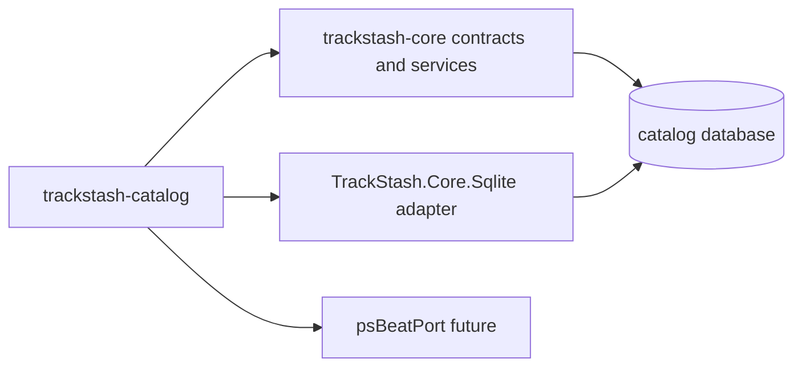

# trackstash-catalog

Canonical catalog and lifecycle operations module for TrackStash.

## Overview

Catalog + artwork and separately configured scanner inventory ZIP backup, verification and safe separate-directory restore are available through the shared native service, CLI and **System → Backup** admin GUI. Set `CatalogApi__ScannerDatabasePath` (or `TRACKSTASH_SCAN_DATABASE_PATH`) to enable scanner backups; CLI uses `--kind scanner`. Neither type copies audio/media files. See [database backups](docs/catalog-backups.md) for configuration, newest-10 retention per database/type, authenticated download and restore instructions.

`trackstash-catalog` owns the day-2 catalog workflows that happen after storage has been initialized.
It builds on shared contracts and services from `trackstash-core` and leaves first-run setup to `trackstash-bootstrap`.

This module is the long-term home for:

- canonical catalog ingestion
- catalog-oriented diagnostics
- lifecycle-safe repair and maintenance workflows
- read/query surfaces for other TrackStash modules

## Why This Module Exists

TrackStash needs a boundary between setup concerns and ongoing catalog work.
`trackstash-bootstrap` should remain small and focused on initialization, migrations, and starter orchestration.
`trackstash-catalog` should own the repeated workflows used during normal operation.

Examples:

- importing curated CSV batches into the canonical catalog
- ingesting Beatport or other external source data
- checking referential integrity and catalog health
- repairing derived indexes or denormalized search structures
- exposing catalog summaries to matching, tagging, and organization flows

## How It Fits In The Project

`trackstash-catalog` depends on shared domain contracts and reusable services from `trackstash-core`.
It should not introduce direct knowledge of SQLite internals into command handlers.



Related module docs:

- `../trackstash-core/README.md`
- `../trackstash-core/docs/ecosystem-modules.md`
- `../trackstash-bootstrap/README.md`

## Responsibilities

`trackstash-catalog` should own:

- operational catalog imports and refreshes
- canonical entity maintenance beyond first-run seeding
- catalog diagnostics such as integrity and completeness checks
- repair flows for indexes and derived search structures
- catalog-facing summaries and inspection commands
- reusable application-layer orchestration for future UI or service hosts

`trackstash-catalog` should not own:

- database bootstrap or migration initialization
- raw filesystem scanning
- audio fingerprint generation
- media-file writeback and tag mutation
- low-level repository and provider contract definitions

## Recording Identity Direction

Use the canonical `Recording` entity for a track/master identity, independently of owned files. A recording may have no media files, may later acquire multiple file representations, and may appear on multiple releases. Remasters have separate recording IDs linked through `remaster_of`; a provider track ID or ISRC is supporting evidence, not the canonical identity.

The agreed policies live in core:

- [Recording identity, portable IDs, and remaster dates](../trackstash-core/docs/recording-schema.md#recording-identity-policy)
- [Identity resolution evidence and backfill safeguards](../trackstash-core/docs/media-matching-schema.md#identity-resolution-policy)

Catalog workflows should preserve assigned recording GUIDs and release memberships, including entries for music not owned locally. Proposed duplicate merges must retain resolvable retired IDs. Matching should produce reviewable file-to-recording decisions; the tagging layer should write `trackstash_recording_id` and appropriate standard date tags, not catalog command handlers.

These policies are a target for integration, not a statement that the live scanner database or current admission scripts already implement canonical recording links, redirects, or recording-ID tag writeback.

## Beatport-Backed Label Seeding

For an initial canonical label catalog, prefer existing Beatport track -> release -> label relationships over unverified media-file label strings. Give each distinct Beatport label ID a canonical GUID and retain the provider ID in `label_external_ref`, with source-table provenance in the payload. Deduplicate observations of the same provider ID across cache/corpus tables.

Use the shared `EntityNameNormalizer.NormalizeStrict` and `NormalizeLoose` helpers to expose name collisions and review candidates. Different provider IDs with identical names must not be silently merged; loose-name or embedding similarity is candidate evidence only. Keep possible imprints/parent labels separate until reviewed. Preserve observed names as aliases.

Bootstrap a separate catalog database through the existing migrations when the source is a scanner database with a different schema. Import through `validate-entity` and `apply-entity`, retaining the assigned GUIDs in reusable entity artifacts. Validate and preview each entity individually: the current validator accepts multi-document YAML, but the apply path expects a single entity document per file.

Seeding does not update media tags or establish file/release links automatically. A subsequent reviewed mapping stage is required for those relationships.

## Label HTTP API and Planned Clients

The [Catalog API design intent](docs/api-design.md) describes the implemented label-first ASP.NET Core host, shared application services, and React-admin GUI, plus a planned PowerShell HTTP client. SQLite remains a storage adapter, not part of the public API contract.

The host and GUI support label list/read/create/edit, alias/provider-reference inspection, and reviewed duplicate-label merges with audit and retired-ID resolution. Relationship editing, safe deletion endpoints, and the PowerShell HTTP client remain future work. The resource boundary leaves room for artists, releases, recordings (abstract tracks), genres/subgenres, and playlists without importing Beatport-specific identities or Library filesystem responsibilities.

### React-admin GUI

Artist browsing is available from the sidebar, linked Release/placement credits and the Label's Artists tab. Search name/sort-name/aliases, page identities and filter primary/remixer credits. Artist detail has Featured/Tracks/Releases/Associations/Details tabs, safe identity/provider metadata, one server-paged row per release/credited placement with aggregated roles and tooltip evidence icons; repeated placements, unplaced Recordings and unresolved compounds remain distinct. Release rows include managed cover thumbnails and linked Labels. Label context reflects credits on linked releases, not artist signing/ownership. Browsing uses schema 9+. Schema 12 adds manual biography/source, typed links, Favourite, private notes/review and managed portrait/gallery with permanent history and original-token conditional writes. The biography pencil edits just biography/source; a heart toggles Favourite, the portrait camera opens artwork management, and Beatport links use a locally bundled logo. Latest-release cards/newest-first ordering and calculated Associations remain planned; identity editing/split/merge is not included. No live database changes are made. See [Artist profile API](docs/api-design.md#artist-manual-profile-and-artwork-schema-12) and the [roadmap](docs/purchase-release-import-design.md#artist-experience-roadmap).

The [admin application](src/TrackStash.Catalog.Admin/README.md) provides searchable, sortable label lists, paged results, detail/alias/provider-reference inspection, and safe create/edit forms. It retains API keys in memory only, disables framework telemetry, and rejects stale edits using the form's original ETag.

Build it before building the API:

```bash
cd src/TrackStash.Catalog.Admin
npm ci
npm run build
cd ../..
```

Then start the API as below and open <http://localhost:5187/admin/>. Enter the key configured for that API. The .NET build copies built assets into its output/publish directory; users running the prebuilt output do not need npm. Source builds require Node.js 22.12 or later. See the [admin instructions](src/TrackStash.Catalog.Admin/README.md) for hot-reload development, tests, and packaging boundaries.

### Running the API Locally

From this module directory, configure an existing canonical catalog migrated to version 8 or later:

```bash
export CatalogApi__DatabasePath="/absolute/path/to/Trackstash.Catalog.db"
export CatalogApi__ApiKey="$(openssl rand -hex 32)"
dotnet run --project src/TrackStash.Catalog.Api
```

The generated key stays in the shell environment, not source control. Configure clients with the same key via their secret/environment facilities; never paste it into tracked files or URLs. A .NET user secret named `CatalogApi:ApiKey` is another option when running in Development. Do not select the scanner inventory database.

The host listens on `http://localhost:5187` (both loopback addresses when available). Change the port with `CatalogApi__Port`. General URL overrides do not enable remote hosting, and custom Kestrel endpoint configuration is rejected. The startup storage check refuses incompatible/uninitialized label storage without applying migrations or seeding.

Every API request, including OpenAPI, requires `Authorization: Bearer <key>`. Keys must have at least 32 characters and no whitespace. Only the public `/admin` shell/assets are exempt; they contain no credentials or catalog data. Browser requests may use the API's own origin or exact additional HTTP(S) loopback origins configured in `CatalogApi:AllowedOrigins`. For Vite development set `CatalogApi__AllowedOrigins__0=http://localhost:5173`; other origins are rejected. Do not deploy behind a proxy or expose over LAN; remote access, TLS, per-user permissions, and key lifecycle management need a separate design.

From another shell configured with the same key:

```bash
curl -H "Authorization: Bearer $CatalogApi__ApiKey" \
  'http://localhost:5187/api/v1/labels?page=1&pageSize=25'
curl -H "Authorization: Bearer $CatalogApi__ApiKey" \
  'http://localhost:5187/openapi/v1.json'
```

The [HTTP request examples](src/TrackStash.Catalog.Api/TrackStash.Catalog.Api.http) cover label CRUD/inspection, both-direction relationship editing, groups/memberships/derived related labels, and merge preview/apply. Reads/creates/edits of a single label, group or membership return a quoted opaque `ETag`. Send that exact value in `If-Match` when editing; missing headers return 428, stale versions 412. Membership writes additionally require both last-read endpoint versions. Configured browser CORS allows GET/POST/PATCH/DELETE, including authenticated membership removal. Do not retry ordinary creation POST automatically: create idempotency is not implemented.

### Manual Label Information

Open an existing label and choose **Edit** to manage description, country/city, founded year, lifecycle, personal notes, favourite, review status, and typed web links (including optional verification source URL). Create a label first, then edit its information. Saves use the original ETag and retain manual before/after revision history; name-only edits and existing CLI imports preserve profiles. Website links do not establish verified provider IDs.

Migration 5 adds this metadata and foundations for source-attributed observations and parent/imprint/distributor links between distinct labels. Migration 6 implements shared artwork and label galleries below. Relationship editing, automated enrichment/providers, and label embedding generation remain deferred. No external sites are fetched. Profile conflicts block a merge; compatible values/links and history carry forward. See [profile contracts](docs/api-design.md#manual-label-profiles) for limits and replacement semantics.

### Label Artwork and Galleries

On label detail, choose **Manage artwork**. Upload a JPEG/PNG logo or gallery image, record usage rights and optional source/attribution, then choose its caption and preference. Uploads save immediately. Reorder/edit/detach entries with **Save gallery changes**; **Replace image** uploads a new asset in the existing position, preserving the old image/history. Stale writes are rejected, not retried. Merges stack the retired label's gallery behind the survivor's, retaining the survivor's preferred image (or carrying forward the retired preference if none).

Originals and thumbnails are managed files **outside the database and Git repository**. The default is .NET's user `LocalApplicationData` directory plus `TrackStash/artwork-data`. Configure an absolute root with `TRACKSTASH_ARTWORK_ROOT` for native migration/tools and API, or override the API with `CatalogApi__ArtworkRoot`. Use the same root for both; changing it does not move existing assets. Roots within Git working trees are rejected. No API content route is public; the browser uses authenticated image requests without putting keys in URLs.

Upload limits: static JPEG/PNG, 10 MiB, 25 megapixels, 16384 pixels per side. SVG, animations, malformed images and oversized uploads are rejected. Original bytes/metadata are retained; 512-pixel JPEG thumbnails apply orientation and omit source metadata. Re-upload to change immutable provenance. Duplicate bytes are not automatically deduplicated across uploads with different source/rights.

**Back up the artwork root together with a consistent database snapshot.** A database-only backup cannot restore new artwork. A coordinated native backup/restore feature is on the [TODO list](TODO.md#shared-artwork-infrastructure); until then stop writers and preserve both matching stores. Detached assets are retained for history, not garbage-collected. Migration 6 exports populated legacy BLOB artwork to the configured root; it never edits migration 5. Unsupported legacy bytes remain preserved, but serving reports an explicit error. See [artwork design and operational rules](../trackstash-core/docs/artwork-design.md).

Release covers now reuse this infrastructure on **schema 11**. Click the cover/placeholder or camera to upload/replace static JPEG/PNG covers with rights/source/attribution, and edit gallery order/captions/preference/detachment; the redundant header management link is removed. The responsive header uses only an explicitly preferred cover, never a Label logo, and shows a Beatport logo link when a valid numeric release ID is known. Tracks use sequential presentation numbers, title/mix, primary Artists followed by remixers and duration; Label links remain in the header rather than repeating them in every track row. Listing and Recording credits are deduplicated by identity/role/spelling, without borrowing release-wide credits; separate provenance and stored numbering remain in expandable track details. No additional migration is required for these presentation changes.

Provider-neutral candidate lookup and explicit attachment are implemented, but **no live Beatport, MusicBrainz/Cover Art Archive or Discogs adapter is registered yet**. Without configured adapters, lookup explicitly reports this. Future adapters supply release-scoped candidate/revision IDs; attachment requires rights and confirmation and stores a validated local copy with immutable provenance. No automatic external-image loading or downloads occur.

Use a backed-up disposable catalog for testing: stop the trial API, migrate that same trial database to the current **schema 12** with the same artwork-root configuration, then rebuild/restart the trial API and refresh the browser. Do not migrate the live catalog without separate approval. Existing schema 9/10 Release browsing still works but Release artwork explicitly requires 11; Artist profile/portrait requires 12. Artist managed portrait/gallery reuses the same storage and rights rules; no Artist provider adapter is included. Recording release-context inheritance remains future work. See [shared artwork design](../trackstash-core/docs/artwork-design.md), [Release API routes](docs/api-design.md#managed-release-artwork-and-provider-candidates-schema-11) and [Artist API routes](docs/api-design.md#artist-manual-profile-and-artwork-schema-12).

### Reviewed Duplicate-label Merges

Open the label you want to keep, then choose **Merge duplicate into this label**. Search by name/alias or provider ID, choose the duplicate, and review the direction, retained provider IDs, aliases, release links, warnings, and blockers. Supply a reason and confirm explicitly. Switching the survivor or refreshing the review requires confirmation again; previews expire after 15 minutes.

One label can already hold several Beatport IDs. Apply atomically transfers supported links, coalesces compatible rows, preserves relational before/after audit evidence, and retires the duplicate ID. Conflicting payloads/roles, ambiguous primary flags, third-party provider conflicts, processing embedding work, and unsupported dependencies block apply. No automatic fuzzy matching, undo, media rewriting, or artist/release/recording merging is included.

Retired HTTP reads redirect to the survivor; writes return `409 label_retired` with the canonical ID. YAML/CSV imports and restores cannot recreate retired IDs, including dry runs of explicit label/release selectors. Merge applies are idempotent for the same operation/ETag/reason/operator; a changed or expired unapplied review requires another preview. See the [merge contract](docs/api-design.md#reviewed-label-merge-design).

**Upgrade before running this version:** stop the old API, make a consistent backup of the canonical catalog, then run the native bootstrap `migrate` command against that catalog (never the scanner database). For example, from the workspace root, after backing up:

```bash
dotnet run --project trackstash-bootstrap/src/TrackStash.Bootstrap -- \
  migrate --provider sqlite --db-path "/absolute/path/to/Trackstash.Catalog.db"
```

Migration 4 adds review/audit/retirement storage and guards, but does not merge or renumber existing labels. Startup refuses older schemas without changing them. Build the admin assets again before rebuilding the API. Protect database/backup access: full audit snapshots can contain provider payloads, and no HTTP endpoint exposes those snapshots. Applied operation outcomes, audits, redirects, and unused reviews are retained; cleanup and undo are not implemented.

### Shared Label Foundation

[TrackStash.Catalog.Application](src/TrackStash.Catalog.Application/LabelService.cs) implements label query/detail/create/conditional-update use cases against core storage interfaces, with no SQLite dependency. Supply a configured `IStorageProvider`; callers cannot select a database through label requests.

Queries return `{ items, total, page, pageSize }`, search names/aliases with shared strict normalization, preserve ambiguous candidates, and support stable sorting and pages up to 100. Updates require the last-read opaque version and distinguish missing labels from stale edits. Explicit field flags preserve omitted values and allow clearing nullable sort names.

The HTTP host requires explicit catalog migration to version 8 before use; it never migrates at startup. Take a verified catalog/artwork backup before upgrading. Existing schema 6 and 7 backups remain supported. Aggregate-version triggers invalidate tokens for label, alias, provider reference, release-label, profile/artwork and both endpoints of relationship/membership changes. Unconditional writers still invalidate versions but must reject retired-ID reuse. The HTTP host uses `ILabelService`, `ILabelMergeService`, `ILabelRelationshipService` and `ILabelGroupService`; no new CLI commands are included.

Label detail supports reviewed **imprint/parent** and **distributor** relationships, inverse navigation, source/evidence/notes, multiple parents, and deliberate conditional save/removal. Migration 7 preserves existing edges, baselines immutable history and rejects imprint cycles. Merge review transfers both directions, coalesces only matching evidence, and blocks conflicts/self-links/cycles. See [relationship contracts](docs/api-design.md#reviewed-label-relationships); dates/territory and automatic enrichment are deferred.

The imprint editor also manages child imprints and distributed labels from their parent/distributor page, storing the same single directed edge. **Label groups**, beside Labels in the sidebar, manages distinct families/brands and organisations with flat, sourced memberships, current/former/unknown status, partial dates and permanent history. Edit the same membership from either endpoint; a return from former to current requires extra review. **Related labels** derives shared recorded-parent, same-family and same-organisation reasons without redundant sibling edges or ownership claims. Migration 8 introduces empty group tables, group-aware merge reviews and conflict-safe transfer. Group nesting, merge/deletion and artwork/aliases/provider references remain deferred. See [group contracts and rollout gates](docs/label-groups-design.md).

See the [implemented contract and remaining decisions](docs/api-design.md#implemented-foundation) for details.

### Next: Reviewed Purchase-to-Release Import

Canonical **Releases** can now be browsed from the left menu or a label's filtered **Releases** tab. Search title/catalog number, page results and click a title to view release metadata, label links, release credits and ordered Recording placements with their own credits. Import outcomes also link directly to **View release**. Browsing is read-only and requires schema 9+; no migration, media inventory or purchase accounting occurs.

The [release-centred import design](docs/purchase-release-import-design.md) uses a purchase/corpus candidate to review one complete Beatport release, resolve its existing label, and create accepted recording placements and individual artist/remixer credits. The first **read-only inspector** is available in **Purchase releases** in the admin sidebar and through:

- `GET /api/v1/purchase-release-candidates?q=325565&page=1&pageSize=25` (add `hideAdmitted=true` to omit releases already in the catalog, and `readyOnly=true` to keep only releases with a complete cached source and exactly one matching catalog label)
- `GET /api/v1/purchase-release-candidates/325565?page=1&pageSize=25`

Set `CatalogApi__PurchaseSourceDatabasePath` to an absolute existing scanner inventory path containing the Beatport corpus/cache tables. If absent, the inspector uses `CatalogApi__ScannerDatabasePath` (or `TRACKSTASH_SCAN_DATABASE_PATH`). The source must be separate from the canonical catalog. Restart the API after configuration/build changes. An unavailable, unconfigured or unsupported source returns safe 503 Problem Details, not an empty success.

The initial queue uses derived purchase-corpus flags, **not receipt accounting**. Inspections expose structured primary/remixer credits, label candidates, cached timestamps, whole-release completeness diagnostics and a source digest, with tracks paged separately. Source completeness does not certify canonical identities or official order; even a complete source requires reviewed import later. Source connections are read-only and never migrate, fetch or update the scanner; the inspector does not write canonical rows either.

**Reviewed apply is implemented for schema 10**, tested only on temporary catalogs. From an inspected release, create an immutable server-side preview, review individual Artist/Recording choices (including unresolved compound identities), and apply with the original ETag, reason and deliberate confirmation. The transaction includes the complete release, placements/credits, accepted references, permanent source/decision/before/after audit, a replay-safe outcome, canonical text documents and durable pending embedding work. No vector generation or media/purchase assertion occurs.

Decision edits create a new immutable preview and supersede the previous one; previews expire after 15 minutes. Source or catalog changes reject apply rather than silently retrying. Existing accepted source content produces a no-op, including an identical cache refresh. Changed or unreviewed existing release graphs are blocked until a separate reconciliation workflow is available; curated metadata and manual order are never replaced. Label identity must already resolve to exactly one active catalog label. Receipt ingestion, provider refresh, Artist split editing and scanner-media resolution remain deferred.

The label/inspector host still supports schema 8. **Do not migrate the live catalog just to inspect releases.** Import requires a separately approved migration through 9/10 after backup verification and rehearsal; no startup or preview operation migrates a database. See the [review/apply contract](docs/purchase-release-import-design.md#implemented-reviewed-import-migration-10-temporary-databases-only).

The minimum shared canonical foundations are now implemented in forward migration **9**, with conditional versions, Artist identity status, Release metadata, Recording duration, stable multi-role credits and repeated placements/manual ordering. They have been validated on temporary databases; **no live upgrade or import has occurred**. The existing label/inspector API remains schema-8 compatible. These are storage foundations, not new public entity editors or reviewed apply endpoints. See [foundation status and remaining work](docs/purchase-release-import-design.md#6-required-core-changes).

### Beatport Broker: Backfill and Browse

When the [Beatport broker](../trackstash-beatport-broker/README.md) is running (`start-prod.sh` starts it and sets `CatalogApi__BeatportBrokerUrl`/`CatalogApi__BeatportBrokerKey`), the catalog API proxies Beatport through it. The broker holds the Beatport session, caches responses and throttles requests; the catalog never stores Beatport credentials.

- **Sign in / status:** `GET /api/v1/beatport/connection`, `POST /api/v1/beatport/sign-in`, `POST /api/v1/beatport/sign-out` (also from the **Purchase releases** page).
- **Backfill purchase data:** `POST /api/v1/purchase-release-candidates/{id}/beatport-backfill` for one release, or the background job at `/api/v1/beatport-backfill-jobs`. Fetched data lands in the broker's tables in the scanner database, which purchase readiness reads.
- **Browse (read-only):** the **Beatport** page in the admin sidebar. Search releases by name and/or Beatport label, sort by newest/oldest/name, expand a release to see its tracks, and search labels by name. Each result shows whether it is already **in the catalog** (via Beatport external references) or in your **purchase history**.
  - `GET /api/v1/beatport/releases?q=&labelId=&artistId=&sort=newest|oldest|name&page=1&pageSize=25` (`q` or a filter is required; `pageSize` ≤ 50)
  - `GET /api/v1/beatport/releases/{id}` (release plus up to 100 tracks)
  - `GET /api/v1/beatport/labels?q=&page=1&pageSize=25` and `GET /api/v1/beatport/labels/{id}`

**Label and Artist pages also have a Beatport tab** that browses store releases inside the entity page, using its verified Beatport external reference. The label header's **Browse on Beatport** button opens this tab rather than leaving the label. Primary IDs are preferred; if several IDs are recorded, choose one with the identity selector. With no usable ID, the tab explains what is missing instead of guessing by name. Search, sort and paging stay scoped to that identity and are retained in the URL independently of catalog filters. Track expansion and catalog/purchase markers are shared with the standalone browser. Store requests only start when the tab is opened.

**Admit purchased releases:** a purchased release without a catalog match has an **Admit to catalog** button in both entity tabs and the standalone browser. It opens the existing immutable import review in a dialog without leaving the page. Create a preview, review/save identity choices, and explicitly confirm before applying. The row gains its catalog link after a successful apply. Closing a review does not apply it; dismissal is disabled while a review request is running. Source-completeness, label-resolution and stale-preview checks remain enforced by the existing import API. Incomplete sources link to Purchase releases for inspection/backfill. Admission creates catalog metadata, not media copies or links; it does not purchase anything from Beatport.

The admission dialog also has **Fetch missing from Beatport**, using the same backfill operation as Purchase releases. Fetching and reviewing cannot run concurrently, and the dialog cannot be dismissed during either operation. A successful fetch displays its completeness/blocker summary and clears the old preview/decisions so a fresh preview uses the updated source. A failed fetch shows its error without discarding the existing review. Fetching never applies an import.

Browsing never writes to the catalog and never adds purchase candidates; responses are only cached by the broker. Errors use Problem Details: `409 beatport_sign_in_required` (sign in first; 409 so the GUI doesn't log you out), `503 beatport_broker_not_configured`/`beatport_broker_unavailable` (start the broker), `404 beatport_release_not_found`/`beatport_label_not_found`, and `400 validation_failed` for bad query values. Beatport is the discovery/shopping integration; playlist/cart writes and audio previews are not implemented. SonoVault is the preferred next enrichment source, subject to a read-only matching/coverage pilot and reviewed changes rather than automatic overwrites. A local wishlist remains a proposal, not a prerequisite for future Beatport playlist/cart integration: see [docs/beatport-wishlist-design.md](docs/beatport-wishlist-design.md).

## Command Surface

Current commands:

- `import-csv`
- `admit-purchases`
- `summary`
- `doctor`
- `delete-entity`
- `repair-indexes`
- `template`
- `validate-entity`
- `apply-entity`
- `get-entity`

Notes:

- `doctor` currently focuses on readiness and consistency heuristics using provider-agnostic contracts.
- `repair-indexes` currently provides an idempotent maintenance entry point and dry-run reporting; backend-specific rebuild actions can be registered as catalog adds derived index structures.

### `admit-purchases`

Batch-admits ready, unadmitted purchase releases using the same rules as the GUI's **Batch admit ready releases** panel. One of `--dry-run` or `--yes` is required:

```bash
trackstash-catalog admit-purchases --db-path ./Trackstash.Catalog.db --source ./JetDrive.Metadata.db --dry-run
trackstash-catalog admit-purchases --db-path ./Trackstash.Catalog.db --source ./JetDrive.Metadata.db --yes
```

- `--source` defaults to `TRACKSTASH_SCAN_DATABASE_PATH`; `--release 1,2` limits to specific releases and `--limit n` caps the count; `--output json` prints the report.
- A real run creates a verified catalog + artwork backup first (`--backup-root`, `--artwork-root`); pass `--no-backup` only if you have just taken one.
- Releases are processed in groups of 25 and each is applied atomically on its own. Stop the API or avoid editing during a run. The exit code is 1 if any release failed.

## Catalog Target Resolution

Catalog commands can now target a logical catalog name instead of requiring a direct database path.

Default behavior:

- selected catalog defaults to `default`
- `--catalog <name>` selects a specific logical catalog
- `--db-path` is still supported as a compatibility override

Examples:

```bash
trackstash-catalog summary --catalog default
trackstash-catalog summary --catalog house --output json
trackstash-catalog import-csv --catalog archive --file ./tracks.csv
```

### Config File Shape

You can define catalog mappings in config (YAML):

```yaml
catalog: default
provider: sqlite
sqlite:
    dbPath: /fallback/default.db

catalogs:
    default:
        provider: sqlite
        sqlite:
            dbPath: /data/trackstash-default.db
    house:
        provider: sqlite
        sqlite:
            dbPath: /data/trackstash-house.db
```

Resolution behavior:

- `catalogs.<name>.provider` overrides top-level `provider`
- `catalogs.<name>.sqlite.dbPath` overrides top-level `sqlite.dbPath`
- if catalog mapping is missing, top-level provider/path are used as fallback

### Environment Variables

Global/default:

- `TRACKSTASH_CATALOG` (selected logical catalog)
- `TRACKSTASH_PROVIDER`
- `TRACKSTASH_SQLITE_DB_PATH`

Per-catalog mapping:

- `TRACKSTASH_CATALOG_<NAME>_PROVIDER`
- `TRACKSTASH_CATALOG_<NAME>_SQLITE_DB_PATH`

Example:

```bash
export TRACKSTASH_CATALOG=house
export TRACKSTASH_CATALOG_HOUSE_PROVIDER=sqlite
export TRACKSTASH_CATALOG_HOUSE_SQLITE_DB_PATH=/data/trackstash-house.db
```

Catalog names in env variables are normalized to lowercase with `_` converted to `-`.

### Precedence

Effective target is resolved in this order:

1. CLI options (`--catalog`, `--provider`, `--db-path`)
2. environment variables
3. config file
4. defaults

## Entity Templates (v1)

`trackstash-catalog` now includes full-schema desired-state YAML templates for canonical entities:

- `templates/entities/label.v1.yaml`
- `templates/entities/artist.v1.yaml`
- `templates/entities/release.v1.yaml`
- `templates/entities/recording.v1.yaml`
- `templates/entities/batch-example.v1.yaml`

These templates are intended to be a common interchange contract for CLI workflows, bash scripts, and PowerShell cmdlets.

See `docs/entity-templates/README.md` for:

- `validate-entity`, `apply-entity --dry-run`, and apply flow
- mode semantics (`replace`, `merge`, `create-only`, `update-only`)
- full-schema field coverage notes and export/import expectations

See `docs/powershell-interface/README.md` for the proposed PowerShell module layout and cmdlet split for artifact authoring, catalog commit/apply, and read/search workflows.

## Entity Command Usage

The entity-oriented command set is intended to support template generation, validation, export, and desired-state apply workflows.

### `template`

Purpose:

- emit a starter YAML entity template for a requested kind

Usage:

```bash
trackstash-catalog template --kind label
trackstash-catalog template --kind recording --output json
```

### `validate-entity`

Purpose:

- parse and validate YAML entity documents against the v1 contract
- return structured validation issues and exit non-zero on invalid input

Usage:

```bash
trackstash-catalog validate-entity --file ./templates/entities/label.v1.yaml
trackstash-catalog validate-entity --file ./templates/entities/batch-example.v1.yaml --output json
```

### `apply-entity`

Purpose:

- apply desired-state entity YAML into a target catalog
- support `replace`, `merge`, `create-only`, and `update-only` modes
- support `--dry-run` planning output without committing writes

Usage:

```bash
trackstash-catalog apply-entity --catalog default --file ./templates/entities/label.v1.yaml --dry-run
```

### `get-entity`

Purpose:

- retrieve one canonical entity and emit desired-state YAML
- supports `label`, `artist`, `release`, and `recording` entity types

Usage:

```bash
trackstash-catalog get-entity --catalog default --type label --id lbl_example_virelith_records --format yaml
```

Likely later commands:

- `import-beatport`
- `rebuild-embeddings`
- `resolve-aliases`
- `show-entity`
- `find-duplicates`

## Ownership Clarification

Current state:

- `trackstash-bootstrap` may expose compatibility wrappers, while `trackstash-catalog` is the primary operational CLI for catalog workflows.
- `trackstash-core` owns reusable storage contracts and services used by catalog commands.
- delete semantics are implemented in shared storage contracts/services and surfaced through `trackstash-catalog delete-entity`.

## Roadmap Note

Planned enhancement: image-aware catalog entity workflows built on core-owned contracts.
`trackstash-catalog` should expose apply/get behavior for entity images (roles like logo/cover/publicity and release-context recording art), while schema, migration, and storage implementation remain in `trackstash-core` and provider adapters.

Target state:

- `trackstash-catalog` becomes the primary CLI and application boundary for `import-csv` and future catalog imports.
- `trackstash-bootstrap` may keep a compatibility wrapper for first-run convenience, but should not become the long-term home for catalog lifecycle features.

## First Milestones

### Milestone 1: CLI and command host

- create the .NET solution and project layout
- add shared config and output conventions aligned with bootstrap
- wire the SQLite provider through core abstractions

### Milestone 2: Move lifecycle import here

- adopt `TrackStash.Core.Services.CatalogImportService`
- expose `import-csv` as the primary operational command
- preserve `--dry-run`, `--fail-fast`, warning counts, and row-level reporting

### Milestone 3: Catalog health and repair

- implement `summary` for quick catalog counts and readiness
- implement `doctor` for integrity diagnostics
- implement `delete-entity` with dependency-aware safety checks after core delete contracts and rules are finalized
- implement `repair-indexes` for derived index refresh and validation

### Planned delete rules

The first delete feature should be conservative and explicit.

- `label` cannot be deleted while any `release_label_link` rows still point to it
- `artist` cannot be deleted while any `release_artist_credit` or `recording_artist_credit` rows still point to it
- `release` cannot be deleted while any `release_recording` or `release_artist_credit` rows still point to it
- `recording` cannot be deleted while any `release_recording`, `recording_artist_credit`, `recording_relationship`, `media_file_recording_match`, or `media_file_recording_candidate` rows still point to it

Rows that are owned by the entity itself should usually be deleted automatically inside the same transaction rather than treated as blockers.
Examples include external references, aliases, and embedding documents.

### Milestone 4: Source ingestion and enrichment

- add external import surfaces such as Beatport ingestion
- support richer alias, relationship, and provenance maintenance
- prepare read models for matching and tagging modules

## Design Constraints

- depend on `trackstash-core` contracts and services instead of duplicating logic
- keep command handlers thin and orchestration-focused
- prefer idempotent operations wherever feasible
- preserve stable JSON output for automation
- keep failure modes explicit, especially for partial imports and repair flows

## Testing Strategy

The first implementation should mirror the testing style already used in neighboring repos:

- integration tests against temporary SQLite databases
- command-level tests for exit codes and output payloads
- focused tests around idempotency, warning emission, and repair safety

## Progress To Date

Implemented:

- CLI scaffold with shared config resolution and text/json output envelopes
- `import-csv`, `summary`, `doctor`, `delete-entity`, and `repair-indexes` command handlers
- provider-agnostic catalog command orchestration via `IStorageProviderFactory`
- integration coverage for import, summary, delete, and command-level CLI behavior

Still evolving:

- richer `doctor` checks for deeper orphan/relationship diagnostics as shared query contracts grow
- backend-specific `repair-indexes` actions for future derived index materializations
- additional provider registrations beyond sqlite

## Current Status

Status: active implementation with core operational commands in place.

`trackstash-catalog` is scaffolded, tested, and usable for import, summary, doctor diagnostics, delete, and repair entry-point workflows.
Ongoing work is focused on expanding diagnostics depth, repair actions, and additional storage provider support.
